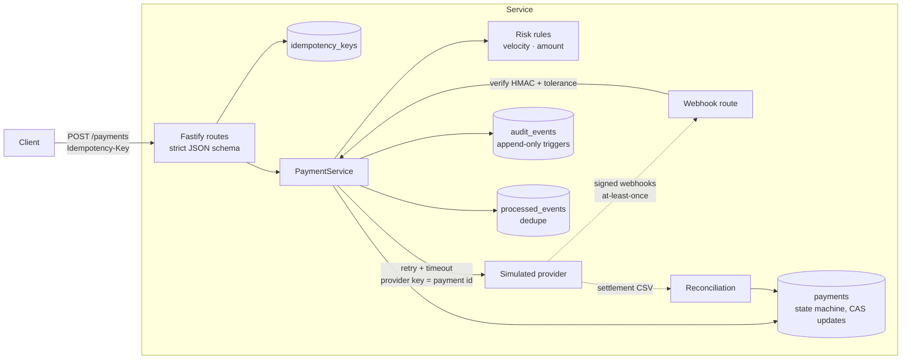
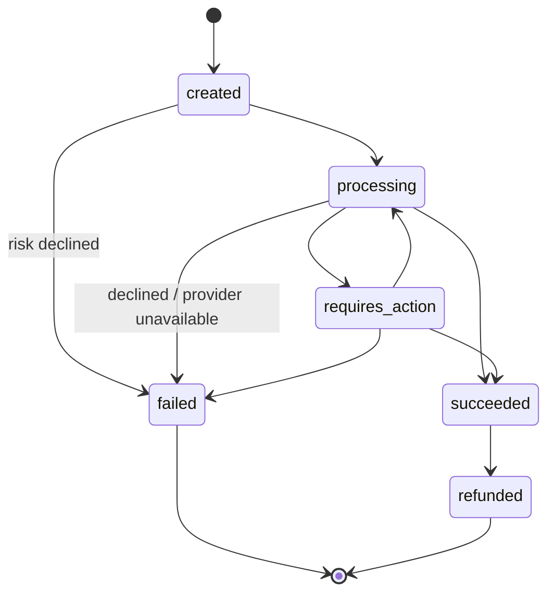
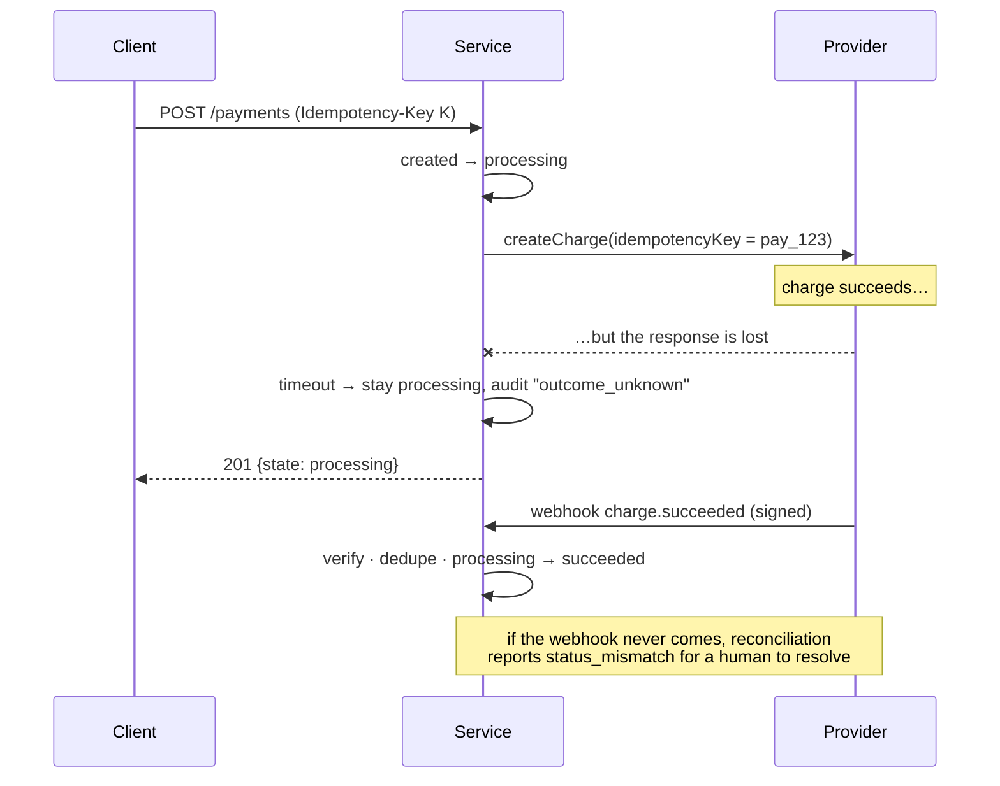

# payments-reliability-lab

**A small payment service built to stay correct when the network, the provider and the client all misbehave.** It covers an explicit payment state machine, Idempotency-Key handling, HMAC-signed webhooks with replay protection, exactly-once event processing, bounded retries, timeout semantics, reconciliation against a settlement file, and an append-only audit trail. 59 tests exercise the failure paths.

[](https://github.com/karthikbhumireddy/payments-reliability-lab/actions/workflows/ci.yml)

> [!IMPORTANT]
> **Simulated provider, no real money.** Every charge goes to an in-process `SimulatedProvider`. There are no real card numbers, endpoints or credentials. This is a learning and portfolio project, not production payment infrastructure, and it is not PCI-scoped.

---

## Why this exists

In payments, the happy path is easy. The incidents come from the edges:

| What goes wrong | What it costs | How this repo handles it |
|---|---|---|
| A user double-clicks Pay, or a mobile client retries after a dropped connection | Customer charged twice | `Idempotency-Key`: same key and same body returns the stored response. A key still in flight returns 409. Provider calls carry the payment id as the provider's own idempotency key. |
| The provider call **times out** | You don't know whether money moved | Never mark it failed and never retry with a new key. The payment stays `processing`, and the webhook or reconciliation settles the truth. |
| Provider returns 503 | Lost sale if you give up, double charge if you retry carelessly | Bounded retries with exponential backoff and full jitter, using the same provider key every time |
| Webhooks arrive twice, late, out of order or forged | Wrong state, fraud | HMAC signature with timestamp tolerance, constant-time compare, event-id dedupe in the same DB transaction as the state change, transitions that can't move backwards, and an amount cross-check |
| Your ledger and the provider's books drift | Unexplained money | Reconciliation classifies every row: matched, amount mismatch, status mismatch, missing at provider, unknown to us |

I worked on payment products across several markets as a product manager. This repo is my hands-on implementation of the reliability concerns I used to write requirements for. It is a clean-room build: no employer code or specs.

## Demo: every failure mode in one command

```bash
git clone https://github.com/karthikbhumireddy/payments-reliability-lab && cd payments-reliability-lab
npm ci
npm run demo
```

Actual output (IDs vary per run):

```text
1) Payment scenarios

scenario                                state            provider calls  reason
succeeds                                succeeded        1
card declined                           failed           1               insufficient_funds
needs 3-D Secure                        requires_action  1
provider 503 x2, then ok                succeeded        3
provider times out (charge DID happen)  processing       1
pending, settles by webhook             processing       1
provider down for good                  failed           4               provider_unavailable

2) Client retries the first request with the same Idempotency-Key
   status 201, replayed=true, charges at provider for it: 1
   same key, different body -> 422 idempotency_key_reused

3) Webhooks arrive: one duplicated, one forged, one late
   charge.succeeded   for pay_360f7a7d… -> applied
   charge.succeeded   for pay_cfab3521… -> applied
   redelivery of evt_5460ed2e…           -> duplicate
   forged signature                     -> 401 signature_mismatch
   late requires_action after success   -> ignored_out_of_order
   timed-out payment is now: succeeded

4) End-of-day reconciliation against the provider's settlement file
   summary: {"matched":3,"amount_mismatch":1,"status_mismatch":0,"missing_at_provider":0,"unknown_to_us":1}
   exception: {"kind":"amount_mismatch",…,"ours":1004,"theirs":990}
   exception: {"kind":"unknown_to_us","chargeId":"ch_orphan_6","theirs":"captured","amount":4200}
```

The simulated provider picks its behaviour from the **last two digits of the amount**, like PSP test cards: `..02` decline, `..03` requires action, `..04` 503 twice then OK, `..05` timeout but the charge succeeded, `..06` pending then webhook, `..07` 503 forever.

To run it as an HTTP server instead (`npm start`), copy [`.env.example`](.env.example) and set `WEBHOOK_SECRET`. Endpoints are documented in [`openapi.yaml`](openapi.yaml).

## Architecture



### Payment states



Every state change is a compare-and-set (`UPDATE … WHERE id = ? AND state = ?`) plus an audit row. An event that would move a payment backwards is recorded as `transition_ignored` rather than applied.

### The timeout case, step by step



More detail and the reasoning behind each choice: [docs/decisions.md](docs/decisions.md).

## Technology decisions

| Choice | Why | Alternative considered |
|---|---|---|
| TypeScript on Node 24, run natively (type stripping) | No build step, strict types, `erasableSyntaxOnly` | `tsx` or `ts-node` (an extra dependency for no gain) |
| `node:sqlite` (built in) | Real transactions, unique constraints and triggers with zero native dependencies | Postgres (correct for production, too heavy for a clone-and-run demo), `better-sqlite3` (native build) |
| Fastify with strict Ajv (`coerceTypes: false`, `removeAdditional: false`) | `"1000"` is not an amount, and unknown fields are errors, not silently dropped | Express plus hand validation |
| Integer minor units | Floats can't represent money exactly | `decimal.js` (unnecessary when amounts are integers) |
| One file per concern, no ORM | Reviewers can read the SQL that enforces the invariants | Prisma or Drizzle |

Runtime dependency count: **1** (`fastify`).

## Testing

```bash
npm test            # 59 tests
npm run coverage
npm run typecheck   # tsc strict, noUncheckedIndexedAccess, exactOptionalPropertyTypes
npm run lint        # biome
```

Last local run (Windows, Node 24.19): **59 passed**. Coverage 95% statements, 89% branches, 97% lines (server entry point excluded). Typecheck and lint clean. CI runs the same on Ubuntu.

The suite covers:

- **Malformed and hostile input:** float, string, zero or oversized amounts, unknown currency, bad customer id, extra fields, malformed JSON, invalid webhook schema.
- **Duplicates:** same key replay, key reused with a different body (422), a duplicate while the first is genuinely in flight (409), key expiry, and stored 4xx replays.
- **Authorization failures:** forged signature, wrong secret, stale or future timestamp, missing or garbage header, secret rotation.
- **Timeouts and provider errors:** a hung call leaves the payment `processing`, transient 503 retries use one provider key and produce one charge, persistent 503 fails safely.
- **State and webhooks:** every legal and illegal transition, duplicate webhooks applied once, a crash mid-apply rolls back the dedupe row so redelivery works, out-of-order events ignored, amount-mismatch events refused, unknown payments acknowledged.
- **Reconciliation:** each exception class from one constructed day, plus malformed settlement files.
- **The database itself:** `UPDATE` and `DELETE` on `audit_events` are rejected by triggers.

## Security and limitations

- **Trust boundaries:** client requests and webhook bodies are untrusted. Webhooks are verified over the raw bytes before parsing is trusted, and their amounts are cross-checked against the stored payment.
- **Secrets:** `WEBHOOK_SECRET` comes from the environment. The demo uses an obviously fake inline secret. CI runs gitleaks over the full history.
- **No authentication on the API.** A real deployment needs merchant API keys, per-merchant idempotency scopes and rate limiting.
- **Single process, SQLite.** CAS updates and unique constraints make the logic correct under interleaving within one process. Multi-instance deployment needs Postgres and row-level locking or `SELECT … FOR UPDATE`.
- **Full refunds only.** No partial refunds, captures or disputes.
- **Out-of-order refunds:** a `charge.refunded` arriving before `charge.succeeded` is ignored. Reconciliation would surface it, but there is no automatic re-fetch from the provider yet.
- **Not PCI-relevant.** No card data is ever handled.

## Roadmap

1. Re-fetch provider state when an out-of-order event is ignored, instead of relying on reconciliation.
2. A transactional outbox for the service's own outbound events.
3. Postgres with a concurrency test that runs two service instances.
4. Partial refunds and the ledger entries they need.

## License

MIT. See [LICENSE](LICENSE). Built by [Karthik Bhumireddy](https://github.com/karthikbhumireddy) with Claude Code as an AI pair programmer. Every output and number in this README comes from a real run of this repository.
